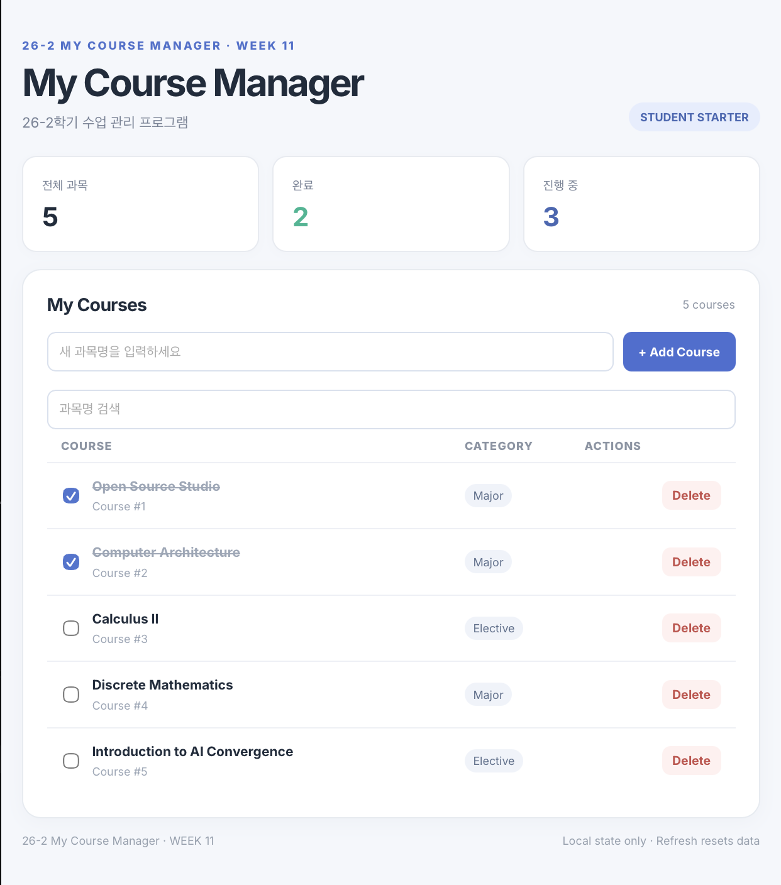
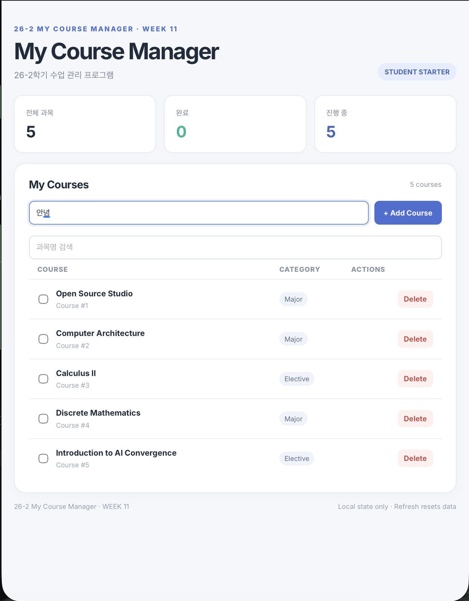
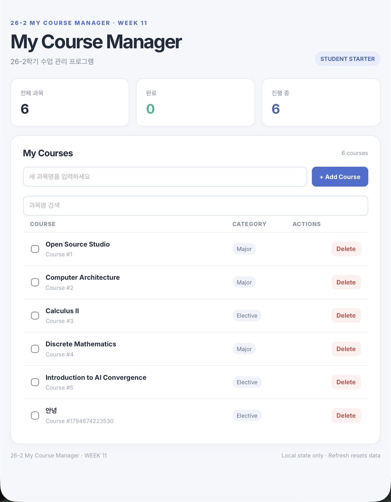
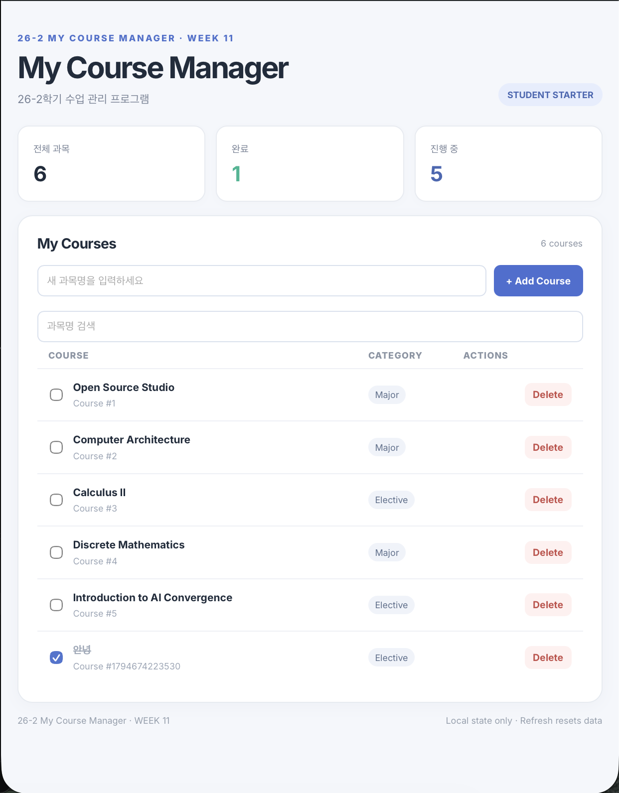
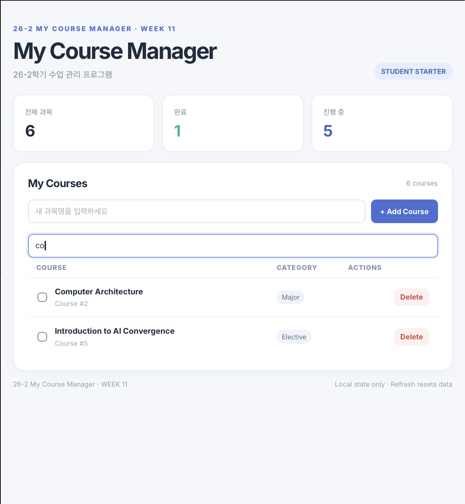

# OSS Week 11 — React Course Manager (Student Starter)

React + Vite 기반 학생 배포용 Sample Project입니다. **조회와 삭제는 완성**, 등록 및 완료 변경은 학생이 직접 구현하도록 `TODO`로 남겨두었습니다.

## 실행 방법

Node.js 20.19+ 또는 22.12+ 권장.

```bash
npm install
npm run dev
```

브라우저에 표시되는 Local URL에 접속하세요. 빌드 테스트: `npm run build`.

## 소스 구조

- `src/App.jsx`: 페이지 전체 레이아웃
- `src/components/CourseList.jsx`: State 및 목록, 삭제 로직, **TODO 1/2**
- `src/components/CourseItem.jsx`: Props로 데이터를 받고 이벤트 콜백 호출
- `src/data/courses.js`: 초기 과목 데이터
- `src/App.css`: 전체 디자인

## 수행 내용

1. 코드를 실행하고 목록 조회·삭제를 확인합니다.
2. 초기 과목 5개 이상, 제목, CSS 3곳 이상 변경합니다.
3. `CourseList.jsx`의 **TODO 1**: 과목 등록 (빈 값 입력 방지, 고유 id 지정, State 업데이트).
4. `CourseList.jsx`의 **TODO 2**: 완료 체크박스 클릭 시 `completed` 상태 변경.
5. 선택: 검색/필터, 이름 수정 기능 추가.
6. GitHub에 Commit/Push 후 Vercel에 배포합니다.
7. README에 프로젝트 소개, 주요 코드 분석 2개, 변경 내용, Weekly Review, GitHub URL, Vercel URL을 정리합니다.

## 확인할 질문

- `CourseList`와 `CourseItem`의 역할은?
- 왜 `courses`를 직접 수정하지 않고 `setCourses()`를 사용할까요?
- `map()`과 `filter()`는 각각 어떤 목적인가요?
- `course`, `onDelete`, `onToggle` Props는 어디에서 전달되나요?
- 브라우저 새로고침 시 데이터가 초기화되는 이유는? (DB/localStorage 없음)

> 교육 목적의 로컬 State 앱입니다. 서버 API 및 데이터베이스는 사용하지 않습니다.

## 1. Project Information: 
- 프로젝트 소개: 과목을 추가하고, 삭제하고 완료 여부를 체크할 수 있는 프로그램입니다.
- 주요 기능: 과목 추가, 삭제, 완료 체크 박스, 검색
- 원본 Sample Project URL: https://github.com/2026-2-OSS/week11_sample_project

## 2. Installation

- 실행 방법
```bash
npm install
npm run dev
```
브라우저에 표시되는 Local URL에 접속하시오.
빌드 테스트: `npm run build`



## 3. Source Code Exploration

1. Project Structure: 주요 파일 3개의 역할
    - CourseList.jsx : 초기 배열을 useState로 관리하고 handleDelete가 삭제 기능을 한다. 그리고 map으로 CourseItem를 반복해서 그린다.
    - CourseItem.jsx : 과목 하나를 그린다.
    - courses.js : 초기 데이터를 저장한다.
2. Component & Props: CourseList와 CourseItem의 관계 및 Props 전달 방식
CourseList가 CourseItem의 부모 컴포넌트로 CourseList에서 map으로 CourseItem을 하나씩 불러와 과목을 하나씩 그리게 한다. CourseItem은 props로 course, onDelete, onToggle 이렇게 데이터와 함수를 받게 된다.
3. State & Event: useState를 이용한 상태 관리 및 삭제 버튼의 동작 원리
useState는 초기에 courses라는 지금 상태값을 만들어서 initialCourses를 처음 값으로 넣어두고 setCourses로 그 값을 바꾸는 함수를 만들어서 이 함수가 실행될때마다 react가 바뀐 값을 화면에 실행되도록 한다.
클릭하게 되면 onDelete가 실행되고 handleDelete함수로 인해 setCourses함수가 실행되어 자료 값이 바뀌고 화면이 갱신된다.
4. Code Analysis: 주요 코드 2개(각 5~15줄)를 선택하여 동작 원리 설명
```jsx
// [제공] 초기 배열을 useState로 관리합니다.
  const [courses, setCourses] = useState(initialCourses);
  const [newName, setNewName] = useState('');

  // [제공] 삭제 기능: filter로 새 배열을 만들어 업데이트합니다.
  function handleDelete(id) {
    if (!window.confirm('이 과목을 삭제하시겠습니까?')) return;
    setCourses(previous => previous.filter(course => course.id !== id));
  } 
  ```
- useState는 자료의 처음상태를 저장하고 값을 바꾸는 함수도 생성하는 역할을 한다.
- filter로 삭제하지 않을 데이터만 골라서 새 배열을 만든다.
- previous로 변경되기 전의 현재 과목 목록을 받는다.

```jsx
<button
    className="btn danger"
    type="button"
    onClick={() => onDelete(course.id)}
    >
    Delete
    </button>
```
onClick로 onDelete를 course.id와 함께 불러서 해당 아이디를 삭제하도록 하였다.

## 4. Customizing

- 과목 5개 변경: courses.js에서 과목 5개로 조건에 맞게 변경
Programming Studio → Computer Architecture
Coding Studio → Calculus II
Web Service Development → Discrete Mathematics
Software Engineering → Introduction to AI Convergence
- 제목·설명 변경: App.jsx와 index.html에서 바꿨다.
OPEN SOURCE STUDIO · WEEK 11 → 26-2 My Course Manager · WEEK 11
React Component, Props & State Practice → 26-2학기 수업 관리 프로그램
OSS Week 11 · React → 26-2 My Course Manager · WEEK 11
OSS Course Manager → 26-2 My Course Manager
- CSS 3곳 변경: App.css에서 바꿨다.
.hero h1 글자 크기: clamp(30px,4vw,44px) → clamp(40px,4vw,44px)
.stat strong.green 색: #16856c → #19b792
.panel 모서리: 18px → 20px

## 5. Feature Extension

1. 과목 추가
```jsx
function handleAdd(event) {
  event.preventDefault();
  const name = newName.trim();
  if (name === '') return;
  const newCourse = { id: Date.now(), name: name, category: 'Elective', completed: false };
  setCourses(previous => [...previous, newCourse]);
  setNewName('');
}
```
preventDefault함수는 폼을 제출할 때 페이지가 새로고침되는 걸 막는다. trim함수는 앞뒤 공백을 지우고 빈 문자열 일시 return으로 끝낸다. 긜고 새 과목 객체를 만들고 만들시 id는 Date.now함수로 지금 현재 시간 숫자로 들어가기 때문에 기존 id와 겹칠일이 없다. [...previous, newCourse]는 기존 과목을 복사하고 뒤에 새 과목을 붙인다. setNewName('')로 입력창을 비운다.




2. 완료 토글
```jsx 
function handleToggle(id) {
  setCourses(previous =>
    previous.map(course =>
      course.id === id ? { ...course, completed: !course.completed } : course
    )
  );
}
```
map 이 과목을 하나씩 돌면서 새 배열을 만들게 된다. id가 같은 과목만 바꾸고 ...course는 기존 값을 복사하고 completed만 true, false를 뒤집는다. 



3. 검색
```jsx 
const [searchText, setSearchText] = useState(''); 

const filteredCourses = courses.filter(course =>    
  course.name.toLowerCase().includes(searchText.trim().toLowerCase())
);

{filteredCourses.map(course => (                    
  <CourseItem ... />
))}
```
검색어를 저장하는 state를 이용해서 줄 검색 입력창의 onChange가 글자를 칠 때마다 setSearchText로 이 값을 바꾼다. includes함수는 과목 이름 안에 검색어가 들어 있으면 true가 된다. 둘 다 toLowerCase 함수로 소문자로 바꿔서 대소문자를 구분하지 않는다. 원래 courses.map이던 것을 filteredCourses.map으로 바꿔서 걸러진 과목만 그리게 된다.



## Deployment: 실제 접근 가능한 Vercel URL 
https://week11-sample-project-omega.vercel.app

## Weekly Review:
- 새롭게 배운 내용 3가지
1. map과 filter를 이용해서 delete를 구현할 수 있는 점
2. useState를 이용하여 데이터나 함수를 생성할 수 있는 점
3. 데이터를 js파일에 넣어서 초기 데이터로 사용할 수 있는 점
- 어려웠던 점과 해결 방법
어려웠던 점은 코딩해야하는 함수들이 어떤식으로 구현해야하는 지 어려웠지만 스스로 고민해보고 안되는 부분을 ai과 해결하면서 코드의 논리를 이해하고 해결해나갔다.
- AI 활용 내용 및 느낀 점
AI를 활용하여 코딩 부분을 수정하고 과제하는 방향성을 추천받아 진행하였으나 AI를 활용하면 내가 스스로 잘했다고 생각이 들지만 정작 내가 스스로 해낸 것이 아니기 때문에 스스로의 능력이 아님을 매번 깨닫게 된다.